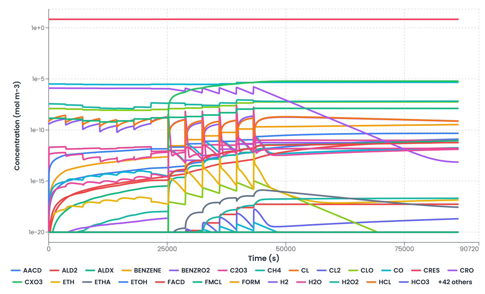
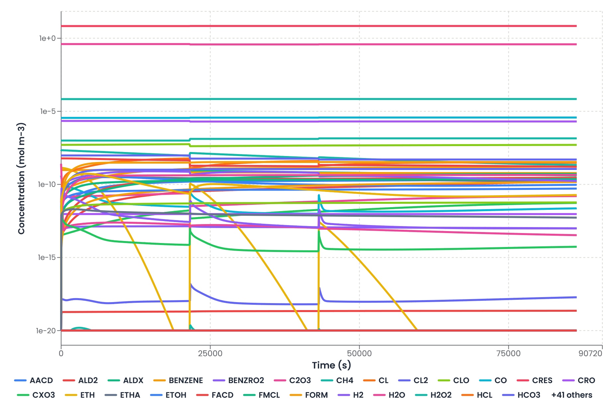

Photolysis, MusicBox Interactive, and model output
===================================================
This document describes how to incorporate the photolysis variables from WACCM and WRF-Chem into MusicBox Interactive. First you will run the examples in their standard configuration, then import your custom model output in CSV files.

Procedure
----------
#. Go through a few MusicBox examples and simply verify that you can run the standard configuration. Since the examples include .csv files, you can include them in a zip file like this::

    music-box/examples> zip -r carbon_bond_5.zip carbon_bond_5/

#. Verify that you have everything needed in the zip file::

    music-box/examples> unzip -l carbon_bond_5.zip
    Archive:  carbon_bond_5.zip
      Length      Date    Time    Name
    ---------  ---------- -----   ----
            0  10-27-2026 11:14   carbon_bond_5/
          756  10-27-2026 11:14   carbon_bond_5/initial_concentrations.csv
          820  10-27-2026 11:14   carbon_bond_5/initial_reaction_rates.csv
       198708  10-27-2026 11:14   carbon_bond_5/my_config.json
    ---------                     -------
       200284                     4 files

#. Upload Config zip file to MusicBox Interactive: https://musicbox-devel.acom.ucar.edu/

#. Run Simulation to verify that you get colorful plots. All of the examples (except waccm, which is empty) should show something realistic.

#. **Now load model results** directly from WRF-Chem and WACCM. Begin by running both models and generating output. These example commands run from the acom_music_box/tools directory, with carbon_bond_5_config.json copied in and renamed from the carbon bond example (originally my_config.json)::

    python3 modelToMusicBox.py --template carbon_bond_5_config.json --wrfchemDir "/home/drews/MusicBox/WRF-Chem/model-output/20250820/wrf/" --date 20250820,20250820 --time 06:00,18:00 --latitude 40.0 --longitude "'-105.0'" --altitude=2000 --verbose --output stuff/Boulder-wrf-chem- carbon_bond_5.csv

    python3 modelToMusicBox.py --template carbon_bond_5_config.json --waccmDir "/home/drews/MusicBox/WACCM/model-output/" --date 20260827,20260827 --time 00:00,12:00 --latitude 40.0 --longitude 255.0 --altitude=2000 --topoFile ~/MusicBox/WACCM/model-output/fv_0.9x1.25_nc3000_Nsw042_Nrs008_Co060_Fi001_ZR_sgh30_24km_GRNL_MERRA2_c171218.nc --verbose --output stuff/Boulder-waccm-carbon_bond_5.csv

#. We recommend using a temporary directory named something like “stuff” so you won’t confuse it later with a real github directory. Your sample output should look like this::

    python/acom_music_box/tools/stuff> ls -ltr
    -rw-r--r-- 1 drews support 4172 Nov  2 14:12 Boulder-wrf-chem-carbon_bond_5.csv
    -rw-r--r-- 1 drews support 1647 Nov  2 14:12 Boulder-waccm-carbon_bond_5.csv

   Both of those CSV files contain 12 hours of environmental conditions. The WRF-Chem file has 13 lines of data because WRF-Chem output is hourly, and the WACCM file contains 3 lines of data because WACCM outputs at 6-hour intervals.

   Note that WRF-Chem and WACCM contribute a different set of variables to MusicBox.

#. Create two zip archives. Edit carbon_bond_5_config.json and replace these files::

    "filepaths": ["initial_concentrations.csv", "conditions_Boulder.csv"]

   with this single file::

    "filepaths": ["stuff/Boulder-wrf-chem-carbon_bond_5.csv"]

   Then run zip::

    acom_music_box/tools> zip carbon_bond_5-wrf-chem.zip carbon_bond_5_config.json stuff/Boulder-wrf-chem-carbon_bond_5.csv

#. Repeat the two parts of step 7 for WACCM::

    -rw-r--r-- 1 drews support 5.2K Nov  2 11:50 carbon_bond_5-wrf-chem.zip
    -rw-r--r-- 1 drews support 1.3K Nov  2 11:28 carbon_bond_5-waccm.zip

#. Open MusicBox Interactive with two browser tabs: https://musicbox-devel.acom.ucar.edu/

   Upload your WRF-Chem config zip file on one tab, and upload WACCM with the other. Run Simulation for both models. Compare with each other and with the original carbon bond configuration. Note that the original configuration is set to run for 3 hours.

#. Set the simulations to run for 24 hours instead (86,400 seconds). The model forcing at 1- and 6-hour intervals should be evident in the plots. After the jagged forcing over the first 12 hours, the chemical reactions settle down.

   Figure 1. Carbon Bond 5 example with WRF-Chem conditions at 1-hour intervals.

   Figure 2. Carbon Bond 5 example with WACCM conditions at 6-hour intervals.

Photolysis
-----------
The WRF-Chem model produces two variables that represent photolysis, as shown here in the NetCDF output::

                PHOTR2:description = "O31D Photolysis Rate" ;
                PHOTR3:description = "O33P Photolysis Rate" ;

By default, these two reactions are mapped to MusicBox-specific names in speciesMap.py::

            "PHOTR2": "jo3_a",  # WRF-Chem: O3->O1D Photoloysis rate (min-1)
            "PHOTR3": "jno2"    # WRF-Chem: O3->O3P Photoloysis rate (min-1)

In this example, modelToMusicBox will produce CSV output files with jo3_a and jno2 in the column titles. You can change that mapping. Note that whatever name you choose should match a reaction in your my_config.json file. Here is the Carbon Bond 5 example::

            {
                "type": "PHOTOLYSIS",
                "name": "jno2",
                "scaling factor": 1.0,
                "reactants": [
                    {
                        "species name": "O3",
                        "coefficient": 1.0
                    }
                ],
                "products": [
                    {
                        "species name": "O3P",
                        "coefficient": 1.0
                    }
                ],
                "gas phase": "gas"
            },

